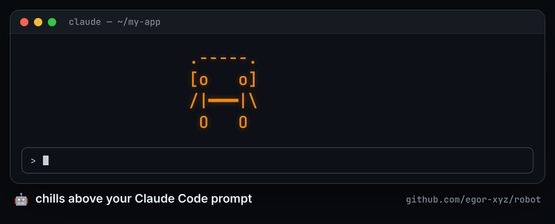
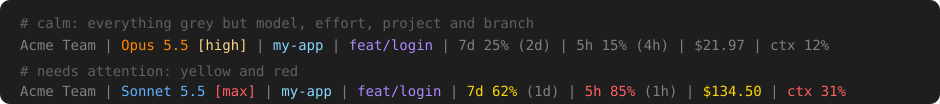

<div align="center">

<a href="docs/media/egor-xyz-robot-demo.mp4"></a>


# robot 🤖

### A little robot lives above your Claude Code prompt. It walks, dances, and goes fishing while Claude works.

**🌐 [egor-xyz.github.io/robot](https://egor-xyz.github.io/robot/)** — see it move

[](#-install-in-claude-code)
[](LICENSE)
[](https://www.zsh.org/)
[](https://egor-xyz.github.io/robot/)

</div>

---

A [Claude Code](https://claude.com/claude-code) mod with an ASCII robot mascot.
It walks the full width of the band above your prompt, blinks, waves, naps under
the moon, shoots hoops, goes fishing, plants a garden and gets abducted by a UFO.

It also follows what Claude Code does:

- 🔥 **Context too big?** Its head catches fire.
- 🧊 **Cache gone cold?** Ice cubes gather around it.
- 📦 **Compacting?** Robots and WALL-Es ride a factory line into boxes.
- 🙈 **Claude asks you something?** It steps aside.
- ✅ **Git commit or push?** It cheers.
- 👯 **Subagents running?** Little WALL-E friends roll in, one per agent.

```text
  .-----.  🐟
  [^   ^]━━/✨
  /|━━━|
   o   o  ~~~~~
```

---

## 🚀 Install in Claude Code

Type these two lines in the Claude Code prompt — that's it:

```text
/plugin marketplace add egor-xyz/robot
/plugin install robot@robot
```

The robot appears above the prompt. No restart needed.

<details>
<summary>Other ways to install</summary>

**From your shell** — one line:

```sh
claude plugin marketplace add egor-xyz/robot && claude plugin install robot@robot
```

**Or just ask Claude:** _"install the robot plugin from egor-xyz/robot"_.

</details>

Works on macOS, Linux and Windows — nothing else to install.

---

## ✨ What it does

- 🤖 **20+ hand-drawn animations.** Walk, dance, jump, sleep, campfire, garden, concert, photoshoot…
- ↔️ **Full width.** The robot walks from edge to edge and follows you when you resize the window.
- 🎨 **Colour per mood.** Each animation has its own colour; dance and jump cycle a rainbow.
- 🙈 **Out of the way.** `/robot` hides it; it steps aside by itself when Claude asks you something.
- 🔥 **Feels the heat.** Past 25% context its head catches fire — [see below](#-context-on-fire).
- 🧊 **Freezes when the cache goes cold.** After a break, ice cubes gather around it and the status line says `❄ cache cold` — [see below](#-cache-cold).
- 📦 **Runs a factory line while compacting.** During `/compact`, robots and WALL-Es pack themselves into boxes on a conveyor belt — [see below](#-compacting).
- 🚀 **Cheers your git.** A ✅ on every commit and a 🚀 on every push.
- 👯 **Brings friends.** Each running subagent is a small WALL-E robot that rolls in behind it, looks around, and rolls away when the agent ends. They hop when the robot cheers a commit. Past three, a `+1`, `+2`… shows how many more run.
- 📊 **Custom status line.** Under the prompt: account, model, effort, branch, usage limits, cost and context — [see below](#-status-line).
- 📂 **Changed files and your PR.** One line counts the files you changed. Click it for a panel with each file and its diff; with a PR open, the files come in two groups, and the title links to the PR — [see below](#-status-line).
- 🙋 **Needs you.** When Claude ends its turn with a question, the robot dances and says _"need a human"_ in a comic bubble.
- 💬 **Robot spinner words.** One robot word per turn: _"Beaming…"_, _"Recharging…"_.
- ⚙️ **Every part has a switch.** Turn each act on or off — [see settings](#settings).
- 🪶 **Tiny.** No daemon, no network, nothing to install.

---

## 👀 It follows Claude Code

The robot listens to Claude Code events and acts on them:

| When Claude Code…                              | The robot…                                                             |
| ---------------------------------------------- | ---------------------------------------------------------------------- |
| fills the context past 25%                     | catches fire and asks you to `/compact` — [more](#-context-on-fire)    |
| compacts the conversation (`/compact` or auto) | runs a box factory line until it ends — [more](#-compacting)           |
| asks you a question or shows a survey          | steps aside so it does not get in the way                              |
| clears or compacts a hot context               | cools down and goes back to play                                       |
| commits or pushes with git                     | stamps a ✅ or waves off a 🚀 for 3 seconds                              |
| runs subagents                                 | rolls in a WALL-E friend per agent — [more](#-subagent-friends)          |
| ends its turn with a question for you          | dances and says "need a human" until you answer                        |

---

## 🔥 Context on fire

The robot watches your session's context window — the same number as the
status line. Once it passes **25%**, the robot drops whatever it was doing:

```text
    .🔥-🔥.
    [O   O]    context 31%
    /|━━━|\    /compact me!
     o   o
```

- 🔥 **Its head catches fire.** The head turns red, flames burn inside it and
  sparks pop beside it.
- 😱 **It panics.** Its eyes flick between `O O` and `> <`.
- 🚶 **It paces.** It walks slowly back and forth with its head on fire,
  stopping now and then to catch its breath.
- 🙌 **It talks to you — every 30 seconds.** It stops, waves its arms and types
  the live context percentage, letter by letter: _"/compact me!"_ No nagging
  in between.

Run `/compact` (or `/clear`) and it cools down at once and goes back to its
normal animations.

**Change when it catches fire:** set **Fire at (% context)** to any value from 1 to 100, or switch
**Context on fire** off — [how to change settings](#settings).

---

## 🧊 Cache cold

Claude keeps your chat in a short-term cache. After 1 hour with no request
(5 minutes on some accounts), the cache expires. The robot freezes:

```text
   🧊·.-----.🧊   ╭───────────────╮
      [o   o]    <  b-b-brr…      │
     */|━━━|\·    │ cache frozen! │
   🧊  o   o 🧊   ╰───────────────╯
>
 ctx 58% | opus | ❄ cache cold · 117k
```

- 🧊 **Ice cubes gather.** The robot stands still and turns blue all over. Ice
  cubes sit by its head and its feet, snow twinkles and its eyes chatter.
  Every 30 seconds it says _"b-b-brr… cache frozen!"_.
- ❄ **The status line says so.** `❄ cache cold · 117k` sits at the end of the
  line. `117k` is the context your next message re-reads.
- 💸 **The next message costs more.** It re-reads the whole context at full
  price, about 10-20 times a cache read. Only that one message pays. Then the
  cache is warm again, and the ice and the `❄` part go away.

What to do:

- Same task? Just send.
- Switching topics? `/clear` first.
- Big context you still need? `/compact` first, so the re-read is small.

The robot does not ping Claude and spends no tokens. It does not read the cache
time from Claude Code. It counts the minutes since Claude's last request. **Cache TTL** is `1h` by default. Is your cache 5 minutes (for example, an API
key)? Set it to `5m`. With `auto`, the robot assumes 5 minutes, and switches to
1 hour, also for later chats, once a chat shows a cache that lived longer. When the head is also on fire, the ice wins.

**Switch it off:** set **Cache cold** to `false` — [how to change settings](#settings).

---

## 📦 Compacting

While the conversation compacts — your `/compact`, or Claude Code's own
auto-compact — the band turns into a factory line. No text, just the belt:

```text
            .-----.
            [o   o]  │       │
            /|━━━|\  │ o   o │
                     └───────┘====>=====>=====>=====>=====>===
```

- 🤖 **One at a time, in the middle.** A unit walks up to the station in the middle of the band. A robot and a WALL-E take turns; who goes first is random.
- 📦 **A new box drops in**, and the unit packs itself part by part: legs or treads first, then the body, then the head or eyes. The lid closes and the box shakes.
- ➡️ **The closed box hops onto a short belt** and rides to its end, where it drops out of sight. The belt shows only while a box is on it. Only then the next unit walks in — a loop for as long as the compaction runs.
- When the compaction ends, the robot goes back to what it did before.

---

## 👯 Subagent friends

When Claude runs subagents, each one is a small WALL-E robot at the robot's back:

```text
                           .-----.
   (o)(o) (-)(-) (O)(o)    [o   o]
   =[##]= =[##]= =[##]=    /|━━━|\
+2 (oooo) (oooo) (oooo)     o   o
```

- 🛞 **They roll in** from the edge when an agent starts. Their wheels pulse, the same as the robot's.
- 👀 **They are alive.** They blink, look around and stretch their necks up now and then.
- 🎉 **They hop** when the robot cheers a git commit or push.
- 🔥 **They panic too.** When the context is on fire, their eyes go wide.
- ➕ **Three at most.** With more agents, a `+1`, `+2`… shows how many more run.
- 👋 **They roll away** when their agent ends.

They always stand on the side away from what the robot does, so they never block the fishing rod or the
balloon. They sit out the cat act.

Under the status line, each running subagent also gets its own line: its task, type, model and effort,
tokens and time. Up to 3 lines show, then `+N more`. They go away when the agents end.

```text
TegoAI Team | Opus 5.5 [high] | robot | feat/login | 7d 27% (1d) | 5h 30% (2h) | $32.68 | ctx 21%
↳ List mod settings | egor-xyz-scout | Haiku 5.5 [low] | 16k tok | 0:06
↳ Count robot animations | egor-xyz-scout | Haiku 5.5 [low] | 21k tok | 0:14
```

---

## 📊 Status line

Under the prompt, the robot draws a custom status line. Claude Code's own hint line stays under it.



```text
Acme Team | Opus 5.5 [high] | my-app | feat/login | 7d 25% (2d) | 5h 15% (4h) | $21.97 | ctx 12%
```

| Part | Shows | Color |
| --- | --- | --- |
| `Acme Team` | your account | grey |
| `Opus 5.5` | the model | 🟠 Opus · 🔵 Sonnet · 🟢 Haiku · 🩷 Fable |
| `[high]` | the effort | grey up to `medium`, then `high` / `xhigh` yellow → `max` red |
| `my-app` | the project folder | teal |
| `feat/login` | the git branch | blue. A worktree folder named like its branch shows once. |
| `7d 25% (2d)` `5h 15% (4h)` | usage limits and the time until they reset | grey → 🟡 at 50% → 🔴 at 80% |
| `$21.97` | session cost | grey → 🟡 above $100 |
| `ctx 12%` | context used | grey → 🔴 at the **Fire at** setting (25%) |
| `❄ cache cold · 117k` | the prompt cache expired; the context your next message re-reads. Shows only while cold, at the end of the line. | 🔵 blue |

**Grey means calm.** A part gets a color only when it needs your attention.

**The PR line.** With a PR open on the branch, one more line shows what needs you:

```text
#12078: conflicts · failing: lint, test · 💬 4
```

The number links to the PR on GitHub. Then come the parts, in this order. A part shows only when it applies.

| Part | Meaning | Color |
|------|---------|-------|
| `#12078` | the PR number, a link | blue |
| `ready` `draft` `checks` `review` `changes` `behind` `blocked` | the state of the PR | 🟢 `ready` · grey `draft` · 🟡 the rest |
| `conflicts` | the branch conflicts with its base branch | 🔴 red |
| `failing: lint, test` | the names of the failed checks. With more than 3, a count: `failing: 4 checks`. | 🔴 red |
| `💬 4` | unresolved review threads | 🟡 yellow |

A new problem pops up once as a toast, for about 8 seconds: a new conflict, a newly failed check, or more unresolved threads. For example `PR #7: failing: lint`. It does not fire when you reload. The **PR line** setting turns the line and the toast off.

The line needs `gh`, signed in. It looks for the PR at once after `git push`, `gh pr …` or a branch switch. Then it looks every 15 seconds while checks run or in the minute after a push, and every 2 minutes when things are calm. A branch with no PR is checked every 5 minutes. It never looks on the default branch or a detached HEAD.

**The branch shimmers.** When the branch changes, or after a git commit or push, a bright band sweeps across the branch name for 3 seconds: blue → purple → pink → orange → yellow.

**Subagents get their own lines.** Each running subagent gets one line under the status line: its task, type, model and effort, tokens and time. Up to 3 lines show, then `+N more`. Agents that already run when you reload plugins or update get their lines back within a second.

```text
Acme Team | Opus 5.5 [high] | my-app | feat/login | 7d 25% (2d) | 5h 15% (4h) | $21.97 | ctx 12%
↳ Find the login form | Explore | Haiku 5.5 [low] | 16k tok | 0:06
↳ Review the diff | tech-lead | Opus 5.5 [high] | 42k tok | 1:12
```

**Changed files get one line.** Under it all, one line counts the files git would commit, with the lines added and removed:

```text
Acme Team | Opus 5.5 [high] | my-app | feat/login | 7d 25% (2d) | 5h 15% (4h) | $21.97 | ctx 12%
5 files changed | +249 | -24
```

With a PR open (found with `gh`), the line counts all the PR's files, committed or not.

Under the mouse, the line shimmers. **Click it, or run `/robot files`, for the list.** A panel opens with each file, as editors list changes: the name, its folder (dim), `+N -N`, and a colored letter: `M` modified, `A` added, `D` deleted.

With a PR open, the panel title links to the PR in the browser, and the files come in two groups:

```text
PR #42 · 14 files changed
Not committed · 2
  SECURITY.md                 +1 M
  notes.txt                   +1 A
In PR · 12
  register.tsx claude-mod +206 -22 M
```

- 📚 Big PRs work too: the panel lists hundreds of files.
- 🔎 Type in the search box to find a file.
- ✨ The file under the mouse gets a soft background, and its name shimmers.
- ⌨️ `↓` from the search box walks the files, and `Enter` opens the file's diff, in color. A mouse click works too: click once to select, click again to open.
- ↗ In the diff, `↗ open` opens the file in its default app. `← files` goes back.
- `Esc` or **Close** closes the panel.

Turn them off with the **Branch wave**, **Subagent lines** and **Changed files** settings.

**Your theme decides the exact colors.** The line uses Claude Code's theme colors (warning, error, …), not fixed ones. It reads well in dark, light and color-blind themes. With a `-ansi` theme in `/theme`, it uses your terminal's own color scheme.

---

## 🎮 Use it

| Command  | Action                 |
| -------- | ---------------------- |
| `/robot` | Hide or show the robot |
| `/robot files` | Open the changed-files panel |

### Settings

Every act has a switch. To change one:

1. In Claude Code, type `/plugin`.
2. Open **Installed**, pick **robot**, then choose **Configure**.
3. Change a value and save.
4. Run `/reload-plugins`, or start a new session.

| Setting | Default | What it does |
| --- | --- | --- |
| Robot | `true` | `false` hides the robot above the prompt. |
| Status line | `true` | `false` hides the [status line](#-status-line) under the prompt. |
| Context on fire | `true` | `false` turns the [burning head](#-context-on-fire) off. |
| Fire at (% context) | `25` | Context % where the head catches fire and `ctx` turns red. |
| Cache cold | `true` | `false` turns the [ice cubes](#-cache-cold) and the status line's `❄ cache cold` part off. |
| Cache TTL | `1h` | How long the prompt cache lives: `1h`, `5m`, or `auto` (5m until a chat shows a 1-hour cache). |
| Compacting factory line | `true` | `false` turns the [factory line](#-compacting) off. |
| Git cheer | `true` | `false` stops the ✅ / 🚀 on commit and push. |
| Subagent friends | `true` | `false` hides the [WALL-E friends](#-subagent-friends). |
| Limits shown | `both` | Which limits the status line shows: `both`, `5h` or `7d`. |
| Limits from (% used) | `0` | A limit shows only from this %. `0` shows it always. |
| Needs you | `true` | `false` stops the "need a human" bubble. |
| Robot spinner words | `true` | `false` keeps Claude Code's own spinner words. |
| Branch wave | `true` | A bright band shimmers across the branch name for 3 seconds when the branch changes, and after a git commit or push. `false` keeps it still. |
| Subagent lines | `true` | One line for each running subagent under the status line: task, type, model, tokens and time. `false` hides them. |
| Changed files | `true` | One line under the status line: how many files git would commit; with a PR open, all the PR's files, committed or not, with the lines added and removed. Click it, or run `/robot files`, for the list. `false` hides it. |
| PR line | `true` | One line under the status line for the branch's open PR: its number (a link), its state, and what needs you: conflicts, failed checks, unresolved review threads. A toast says when something new needs you. Uses `gh`. `false` hides both. |
| Reset all settings to default | `false` | Set to `true` and save: every setting goes back to its default, and this switch goes back to `false`. |

`/robot` hides or shows the robot for this session only.

### Update or remove

```text
/plugin marketplace update robot     # get the newest robot
/reload-plugins                      # use it now
/plugin uninstall robot@robot        # remove it
```

---

## 🔧 How it works

A Claude Code mod is a small plugin that can draw inside Claude Code. This one
lives in [`claude-mod/`](claude-mod/):

1. The mod computes its frames itself, in plain TypeScript — no shell, no
   `zsh`, no other program. [`claude-mod/robot.ts`](claude-mod/robot.ts) is a
   TypeScript twin of [`functions/crazy-robot`](functions/crazy-robot): the
   same animations, timings and colours.
2. It steps one frame per tick, 4 frames a second, in the band above the
   prompt, sized to your window.
3. When you resize the window, the next frame just uses the new width.

A parity test (`claude plugin test .`) holds the twin to the real zsh frames,
tick by tick, so the two stay in step. A new animation needs the same change in
both files.

---

## 🖥️ Bonus: the robot in your terminal

The same robot also runs as a full-screen terminal toy, in the spirit of
[`cmatrix`](https://github.com/abishekvashok/cmatrix) and `sl` — with a
slot-machine easter egg. 🎰

```sh
curl -fsSL https://raw.githubusercontent.com/egor-xyz/robot/main/install.sh | bash
robot
```

Re-run the install line later to update — it pins your local copy to the latest
[GitHub Release](https://github.com/egor-xyz/robot/releases) tag.

| Key         | Action                            |
| ----------- | --------------------------------- |
| `↑` / `↓`   | Cycle animations (also `k` / `j`) |
| `→`         | Open settings                     |
| `←`         | Back to the robot (from settings) |
| `Space`     | 🎰 Slot machine                   |
| `q` / `Esc` | Quit                              |

<details>
<summary><b>Install with a zsh plugin manager</b></summary>

**antidote / antibody**

```zsh
antidote bundle egor-xyz/robot
```

**zinit**

```zsh
zinit light egor-xyz/robot
```

**sheldon** — `~/.config/sheldon/plugins.toml`:

```toml
[plugins.robot]
github = "egor-xyz/robot"
```

**oh-my-zsh** (custom plugin)

```sh
git clone https://github.com/egor-xyz/robot.git \
  ~/.oh-my-zsh/custom/plugins/robot
```

Then add `robot` to your `plugins=(...)` line.

**Manual**

```sh
git clone https://github.com/egor-xyz/robot.git ~/.robot
echo 'source ~/.robot/robot.plugin.zsh' >> ~/.zshrc
```

</details>

<details>
<summary><b>Terminal settings</b></summary>

Open the settings panel with `→`, or set the variable in `~/.zshrc` before
sourcing the plugin.

| Variable            | Default | Effect                                                                                                                |
| ------------------- | ------- | --------------------------------------------------------------------------------------------------------------------- |
| `ROBOT_TIPS`        | `1`     | `0` hides the hint line under the robot for a cleaner screensaver.                                                    |
| `ROBOT_AUTO_UPDATE` | `0`     | `1` fetches tags and checks out the latest GitHub Release in the background, once per launch. Visible on next launch. |

Settings toggled in the panel persist to `~/.config/robot/settings`. The
terminal toy needs `zsh` ≥ 5.0, plus `git` + `curl` only for the optional
self-update.

</details>

---

## 📦 Versioning

Versions follow [Semantic Versioning](https://semver.org/) and are derived from
the closest tag. The installer and the in-shell updater pin to the latest
published [GitHub Release](https://github.com/egor-xyz/robot/releases) — never
the tip of `main`. Releases are cut automatically by `semantic-release` from
[Conventional Commits](https://www.conventionalcommits.org/) PR titles.

---

<div align="center">

Made with 🤖 by [@egor-xyz](https://github.com/egor-xyz) · MIT

</div>
